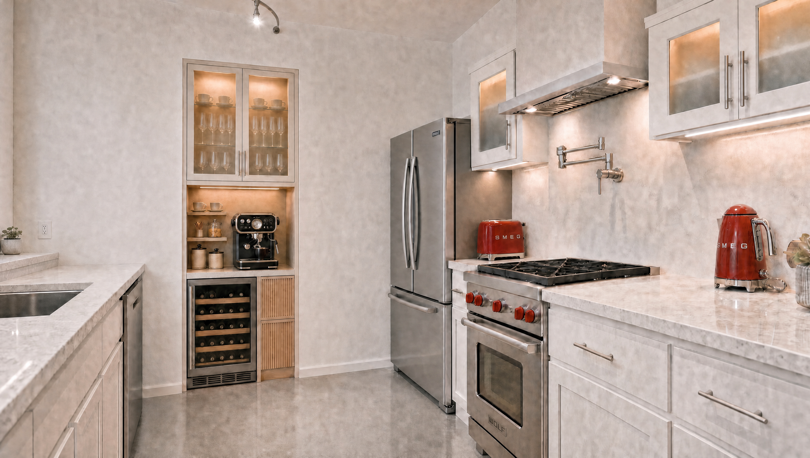
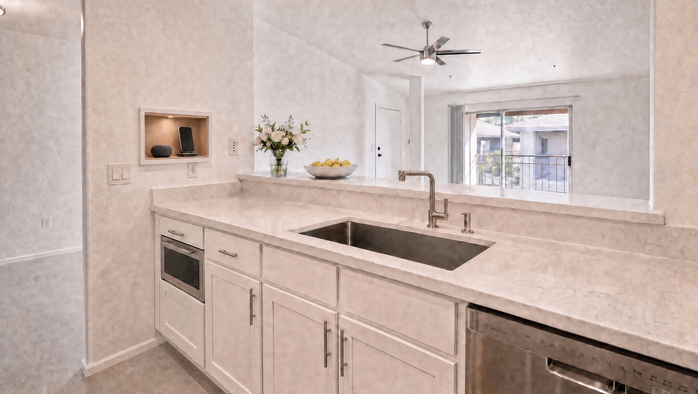
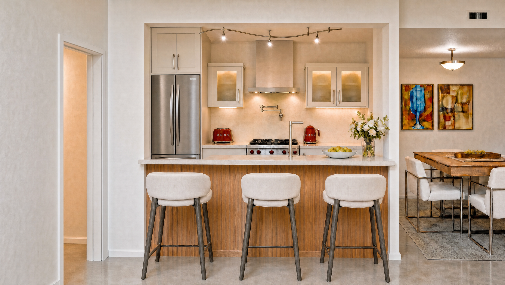

# Help requested from Anthropic Opus — Vero kitchen film

Prepared 2026-10-10, America/Phoenix. Workspace: `/Users/stefansassoon/projects/vero-kitchen-film`.

> **Status update 2026-10-10:** B06a resolved — Stefan accepted the unpaid local correction
> `outputs/keyframes/kitchen-smeg-enclosure-v2.png` as selected view 1
> ([review](docs/B06A-LOCAL-ENCLOSURE-REVIEW.md)). The view-1 entries below are the pre-correction
> record. Current work is B07; see [HANDOFF](HANDOFF.md) and [BACKLOG](docs/BACKLOG.md).

## Request to Opus

Please help resolve the remaining three-view continuity problem, then help carry the kitchen-remodel film toward completion. Preserve Stefan's selected design and use a controlled correction method of your choosing. Do not restart design exploration.

**Codex has not completed this job.** The finished-view consistency issue remains unresolved, and the requested 60-second film has not been produced. Stefan requested this handoff to obtain Opus's assistance. This document is the assistance request; no message has been sent to Opus and no Opus session has been started.

## Immediate objective — B06a

Correct **view 1** so its refrigerator installation matches **view 3**, while preserving the camera, room boundaries, range/hood and adjacent-cabinet relationship, north-wall coffee/wine station, and the remaining selected appearance. Keep views 2 and 3 unchanged.

View 1 currently has a freestanding French-door refrigerator with bare wall above. View 3 has the user-selected fitted enclosure and two-door upper cupboard. Stefan explicitly restored view 3 after a local 3D detour and said to move on. Treat that restored photographic image as the appearance authority for this installation; do not replace it with a CAD-derived interpretation.

The last attempt, `outputs/keyframes/master-third-view-continuity-v1.png`, is **rejected**: it shifted the fridge toward the range and removed the intervening glass-front upper. It is evidence only, not an input to promote. Review: [THREE-VIEW-CONTINUITY-REVIEW](docs/THREE-VIEW-CONTINUITY-REVIEW.md). Structured audit: [three-view-continuity-audit.json](outputs/production/three-view-continuity-audit.json).

### Acceptance

- View 1 reproduces the selected fridge/enclosure appearance from view 3 in view 1's perspective.
- Room boundaries, camera, range position and required adjacent cabinetry remain coherent; no new layout drift.
- North coffee/wine station and west phone/speaker nook stay in their correct locations.
- Views 2 and 3 remain byte-identical unless Stefan explicitly authorizes changing them.
- Inspect the actual corrected image against all three sources before claiming success. Save the result, method/receipt and review, then seek visual acceptance.
- Selection is visual approval, not a surveyed installation or appliance-clearance certification.

## Selected images — inspect these actual files first

### View 1 — north/east interior



- Selected file: `outputs/keyframes/kitchen-smeg-realism-v1.png`
- Absolute path: `/Users/stefansassoon/projects/vero-kitchen-film/outputs/keyframes/kitchen-smeg-realism-v1.png`
- Stable asset ID: `ASSET-D274492F408A`
- SHA-256: `488e9ffedae8f794c97d71a726ffb045a984e095fe85e51b57d1628a25a293fb`
- Selection record: [outputs/production/north-east-visual-lock.json](outputs/production/north-east-visual-lock.json)

### View 2 — west sink wall



- Selected file: `outputs/keyframes/west-phone-speaker-realism-v1.png`
- Absolute path: `/Users/stefansassoon/projects/vero-kitchen-film/outputs/keyframes/west-phone-speaker-realism-v1.png`
- Stable asset ID: `ASSET-1F52D89A0669`
- SHA-256: `b0b80c58c7cdf947d88013dbbb16bd9f5688d6cce8a4a4be06a68303de70c88d`
- Selection record: [outputs/production/west-visual-lock.json](outputs/production/west-visual-lock.json)

### View 3 — living-room-facing kitchen



- Selected file: `outputs/keyframes/apartment-fridge-reconstruction-v11.png`
- Absolute path: `/Users/stefansassoon/projects/vero-kitchen-film/outputs/keyframes/apartment-fridge-reconstruction-v11.png`
- Stable asset ID: `ASSET-F10EDB60E4A0`
- SHA-256: `bc6a5b27c05a960c010e0a2404f7bd98fb7f43f92b7cebed6b3e8a48594e9649`
- Selection record: [outputs/production/apartment-visual-lock.json](outputs/production/apartment-visual-lock.json)

## Orientation and the digital nook

Stefan confirmed these discussion directions: **north** = coffee/wine end wall, **east** = refrigerator/cooking run, **west** = sink/pass-through/bar side, **south** = kitchen access.

The compact nook contains an iPhone on its charging dock and a small speaker, with oak lining. It is visible in view 2 on the kitchen-facing west wall. View 3 looks toward the kitchen from the living room at the opposite face of that wall; the nook is hidden. It is also outside view 1's visible west-wall crop. **Do not move or duplicate it onto another wall to force visibility.** Planned take 09D provides west-facing coverage.

## Preserve the selected design

White Shaker and frosted cupboards, warm internal/undercabinet light, pale veined stone, Wolf-style gas range/red knobs and pale hood/pot filler, red SMEG appliances, concrete floor, ribbed-oak bar, three cream stools and the selected dining composition. Microwave is BELOW the counter LEFT of the west sink. Single basin, L-shaped faucet and dispenser; clear dishwasher working counter.

North station: selected black/brass dial espresso machine, espresso-service shelves, coffee canisters, raw-sugar jar/spoons, wine/cappuccino storage, wider wine front and narrow ribbed-oak storage. Do not revive spice jars in the west nook, above-DW coffee, projecting wine tower, new decorative proposals, or a single-door refrigerator. Retain the restored image as supplied rather than using historical critiques as a reason to reopen it.

## Authority and spending — hard boundary

- Approved task ceiling: **303 Higgsfield credits**.
- Recorded commitments/completed job quotes: **302.25** across 48 terminal generated jobs. **0.75 remains.**
- Last account snapshot: 3929 credits after the last job; account funds are separate and do not authorize task spending.
- `outputs/production/state.json` has `generation_allowed: false`; no authorized or pending new jobs.
- The user's request is to prepare this assistance handoff. **No new paid generation, upload/quote flow, retry, top-up, video batch, publishing or scheduling is authorized by it.**
- Read [budget.json](outputs/production/budget.json) and the last [authorization](outputs/production/master-third-continuity-authorization.json). Inspect receipts before any retry; do not duplicate unknown-outcome jobs.
- Existing runner [run_image_job.py](tools/run_image_job.py) enforces generation state, job allowlist and budget. Do not bypass it.
- Read-only inspection and bounded unpaid preparation may proceed. Obtain a concrete new allowance before paid execution. No unbounded full-frame rerolls.

## Current artifacts and what is unfinished

- Selected photographic references above, plus [catalog/gallery](outputs/stills-gallery.html) with 82 still/reference/review images and 3 diagnostic videos. Counts include source/technical images, not 82 paid generations.
- [Current brief](mega-prompt.md), [ordered backlog](docs/BACKLOG.md), [editable shotlist](outputs/shotlist.html), [construction-state plan](outputs/production/construction-state-plan.json).
- Shotlist: 13 editorial shots, 30 atomic planned takes, exact 60-second edit. Generation duration and source trims remain planning placeholders; all final takes remain unproduced/unaccepted.
- Worker reference: `outputs/keyframes/workers-v1.png` (lead re-inspected; grey-haired lead/navy shirt/tan belt, partner grey shirt/dark cap/dark belt). Preserve identities.
- No current reviewed construction START/END frame set; no accepted final production clips or assembled 60-second film.
- Historical pilots: quartz failed seating endpoint; stool failed final orientation; fridge pilot was only a sampled provisional motion candidate and uses obsolete appearance. Do not reuse as approved production.
- Local 3D geometry/material studies are **archived experiments, not production references**. Stefan explicitly restored the photographic image. Do not resume that workflow without his direction.

## After B06a is accepted

Complete B07's cumulative construction-state frames from the selected photographic references. Start with matching quartz-seating start/end states and a bounded 03A motion pilot; inspect actual seating/contact before wider production. Keep old fridge until Shot 07, sink-side microwave by Shot 04, cooking equipment by Shot 06, lights on from Shot 08, furnishing/visible work through second 55, then reveals. Follow the existing backlog and quote a concrete production allowance before any batch.

Final deliverable: `outputs/kitchen_remodel_60s.mp4`, 1920×1080, 24 fps, exactly 1440 frames/60.000 seconds, H.264/AAC construction sounds only; two consistent workers; 13 named shot exports and editable shotlist. No narration, music, captions or overlays.

## Sources, history and safe checks

- [SOURCE-REGISTER](docs/SOURCE-REGISTER.md): original photos/plans/manufacturer documents and provenance. Source workspace is `/Users/stefansassoon/projects/vero/deco`. Do not edit original drawings to fit a generated image.
- Original camera/topology files: `references/original/ref-a-cooking-run.webp`, `ref-b-sink-run.webp`, `ref-h-apartment-facing.webp`.
- Dimensions are estimates, not a survey. The later 36-inch fridge/enclosure direction superseded the early 33-inch/no-surround instruction. The selected appearance still controls; there is no permission for another design detour.
- [Inspection history](outputs/inspection.txt) and [job ledger](outputs/production/budget.json) retain receipts/statuses. Historical docs are not current instructions.
- Prior accumulated entry documents are preserved under `docs/archive/pre-opus-handoff-2026-10-10/`; [snapshot manifest](docs/archive/pre-opus-handoff-2026-10-10/snapshot-manifest.json). Current entry docs supersede their status language.

```sh
python3 tools/build_asset_catalog.py
python3 tools/verify_handoff.py
```

These checks verify records/links/hashes, not visual correctness. Preserve other writers' changes; stage only relevant paths. Use the actual executing harness's author attribution. For Codex commits: `git -c user.name="Stefan Sassoon (Codex)" commit ...`; do not persist that identity in repository config.
